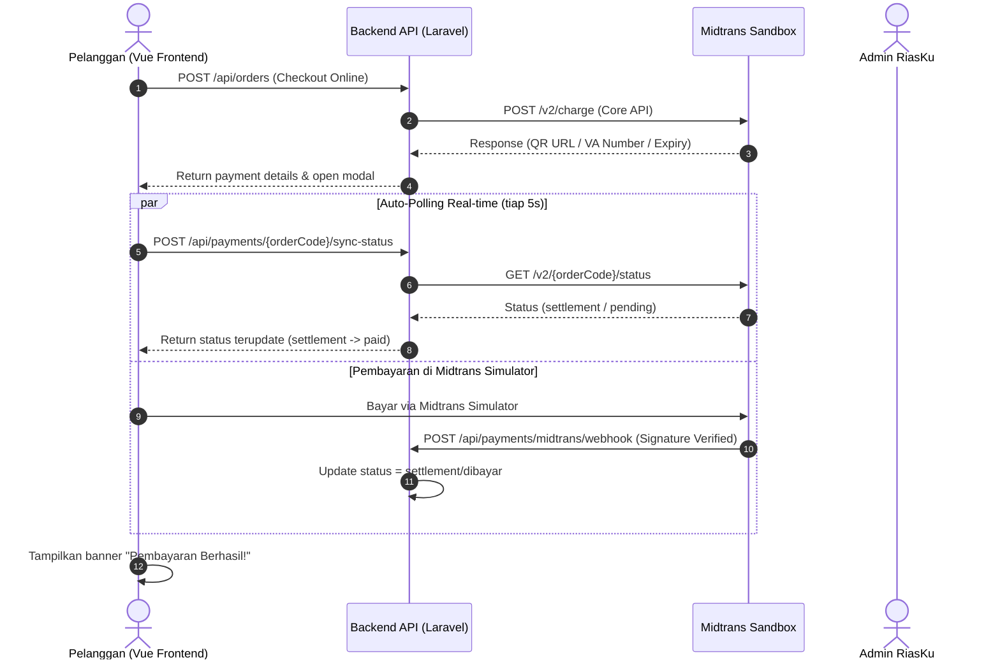

# RiasKu API Contract & Integration Reference

Dokumen ini memuat kontrak resmi integrasi Backend API Laravel (`backend-api/`) dan Frontend Vue 3 (`frontend/`) untuk modul Katalog, Keranjang, Checkout, Pembayaran Midtrans Real-time (PPL-19), dan COD Khusus Kota Surabaya (PPL-20).

---

## 1. Daftar Endpoint API

### A. Autentikasi & Pelanggan
| Method | Endpoint | Auth | Deskripsi |
|---|---|---|---|
| POST | `/api/auth/register` | Public | Registrasi akun pelanggan baru |
| POST | `/api/auth/login` | Public | Login pelanggan (email/username & password) |
| POST | `/api/auth/google` | Public | Login via Google One Tap / OAuth |
| GET | `/api/auth/me` | Bearer Token | Data profil pelanggan yang sedang login |
| POST | `/api/auth/logout` | Bearer Token | Menghapus token autentikasi pelanggan |

### B. Katalog & Keranjang Belanja
| Method | Endpoint | Auth | Deskripsi |
|---|---|---|---|
| GET | `/api/categories` / `/api/kategori` | Public | Daftar kategori produk |
| GET | `/api/products` / `/api/produk` | Public | Katalog produk (filter search, category, sort) |
| GET | `/api/products/{id}` / `/api/produk/{id}` | Public | Detail produk & daftar varian aktif |
| GET | `/api/cart` | Bearer Token | Daftar item dalam keranjang belanja pelanggan |
| POST | `/api/cart/items` | Bearer Token | Menambahkan produk & varian ke keranjang |
| PATCH | `/api/cart/items/{id}` | Bearer Token | Mengubah kuantitas item keranjang |
| DELETE | `/api/cart/items/{id}` | Bearer Token | Menghapus item tertentu dari keranjang |
| DELETE | `/api/cart` | Bearer Token | Mengosongkan keranjang belanja |

### C. Pesanan & Checkout (PPL-19 & PPL-20)
| Method | Endpoint | Auth | Deskripsi |
|---|---|---|---|
| POST | `/api/orders` / `/api/checkout` | Bearer Token | Membuat pesanan baru, validasi stok atomik (`DB::transaction`), inisiasi pembayaran |
| GET | `/api/orders` | Bearer Token | Daftar riwayat pesanan milik pelanggan |
| GET | `/api/orders/{id}` | Bearer Token | Detail lengkap pesanan pelanggan |
| GET | `/api/orders/{orderCode}/track` | Public | Pelacakan pesanan publik untuk pembeli/tamu |

### D. Pembayaran Midtrans Sandbox & Simulator (PPL-19)
| Method | Endpoint | Auth | Deskripsi |
|---|---|---|---|
| POST | `/api/orders/{id}/payments` | Bearer Token | Membuat ulang / mengambil instruksi pembayaran aktif |
| GET | `/api/payments/{id}` | Bearer Token | Detail pembayaran (status, nomor VA, payload QRIS) |
| POST | `/api/payments/{orderNumber}/sync-status` | Bearer Token / Public | **Live Sync Real-time**: memanggil `GET Midtrans /v2/{order_id}/status`, sinkronkan status ke DB lokal |
| POST | `/api/payments/{id}/simulate-pay` | Bearer Token | Simulator pelunasan instan offline/lokal |
| POST | `/api/payments/midtrans/webhook` | Public | Webhook resmi notifikasi Midtrans (verifikasi signature SHA512) |
| POST | `/api/payments/midtrans-notification` | Public | Alias kompatibilitas webhook notifikasi Midtrans |

### E. Manajemen Pesanan Admin (PPL-20 COD)
| Method | Endpoint | Auth | Deskripsi |
|---|---|---|---|
| GET | `/api/admin/orders` | Admin Token | Daftar seluruh pesanan toko (filter status, search, paginasi) |
| GET | `/api/admin/orders/{id}` | Admin Token | Detail pesanan dan info pembayaran |
| PATCH | `/api/admin/orders/{id}/status` | Admin Token | Mengubah status pesanan (`menunggu_pembayaran`, `diproses`, `dikirim`, `selesai`, `dibatalkan`) |
| POST | `/api/admin/orders/{id}/confirm-cod-payment` | Admin Token | **PPL-20**: Konfirmasi "Uang Tunai Diterima" dari kurir COD Surabaya |

---

## 2. Struktur Payload Checkout (`POST /api/orders`)

```json
{
  "customer_name": "Nadia Safitri",
  "customer_phone": "081398765432",
  "shipping_address": "Jl. Manyar Kertajaya No. 45",
  "shipping_city": "Kota Surabaya",
  "shipping_district": "Gubeng",
  "shipping_postal_code": "60281",
  "payment_method": "online",
  "payment_channel": "qris",
  "notes": "Titipkan satpam jika rumah kosong",
  "items": [
    {
      "produk_id": 1,
      "produk_varian_id": 2,
      "quantity": 1
    }
  ]
}
```

### Aturan Validasi Khusus:
1. **COD Surabaya (PPL-20)**:
   - Jika `payment_method: "cod"`, `shipping_city` **wajib** memuat kata `"surabaya"` (case-insensitive).
   - Jika di luar Surabaya, server mengembalikan **HTTP 422 Unprocessable Entity**:
     ```json
     {
       "message": "Metode pembayaran COD hanya tersedia untuk pengiriman wilayah Kota Surabaya.",
       "errors": {
         "shipping_city": ["Wilayah ini di luar jangkauan layanan COD Surabaya. Silakan gunakan Pembayaran Online."]
       }
     }
     ```
   - Status pesanan COD langsung berstatus `order_status: "diproses"` dan `payment_status: "menunggu_pembayaran_cod"`.
2. **Pembayaran Online Midtrans (PPL-19)**:
   - Channel yang didukung: `qris`, `bca_va`, `bni_va`, `bri_va`, `mandiri_va`, `gopay`, `shopeepay`.
   - Menghasilkan nomor VA asli atau QRIS URL dari Midtrans Core API `/v2/charge`.
   - Status awal: `order_status: "menunggu_pembayaran"`, `payment_status: "menunggu_pembayaran"`.

---

## 3. Alur Sinkronisasi Real-Time Midtrans (PPL-19)


